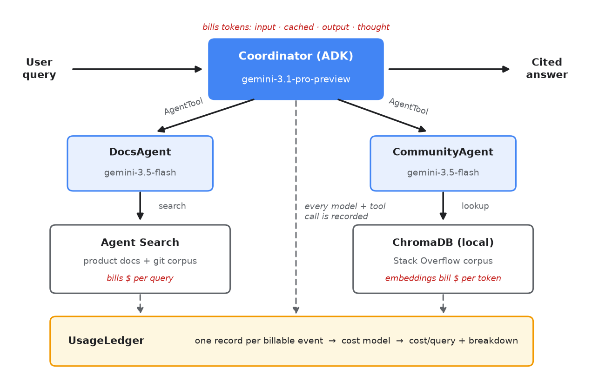
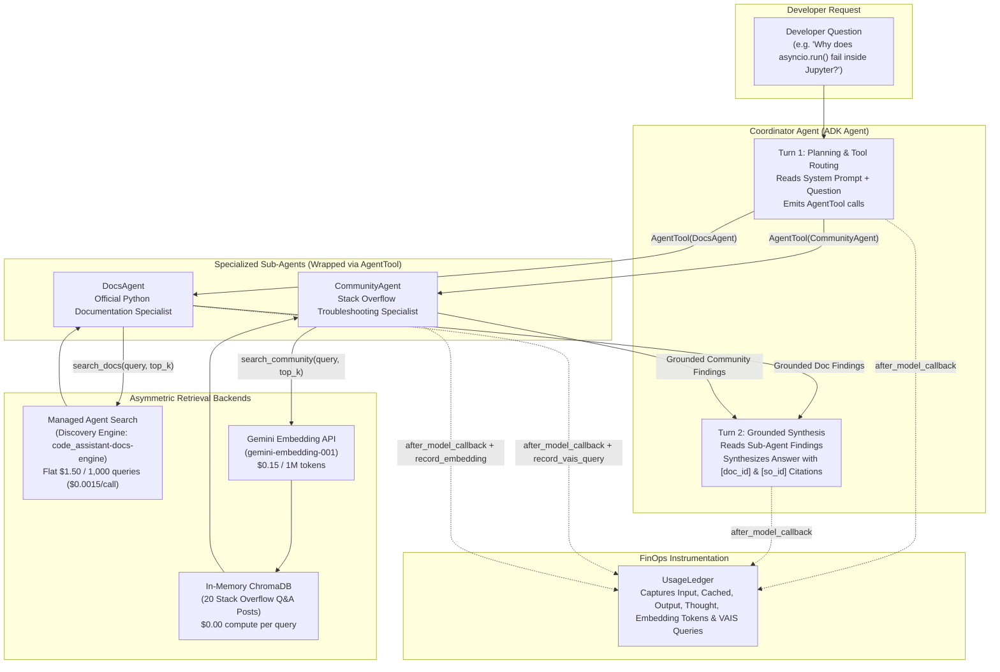
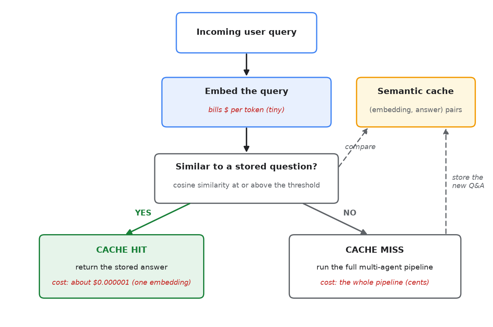

# [FDE] Cost/Token Estimation, Analysis, and Optimization: Challenge Lab

[](https://cloud.google.com/vertex-ai)
[](https://google.github.io/adk-docs/)
[](https://cloud.google.com/vertex-ai/generative-ai/docs/models)
[](https://cloud.google.com/generative-ai-app-builder/docs)
[-2EA043?style=for-the-badge)](./final_metrics.json)

> **Production FinOps & Quality Engineering for Multi-Agent Systems**
> A complete, industry-standard engineering reference and solution guide for auditing, attributing, and optimizing the per-query token and service cost of a multi-agent **Code Assistant Agent** built with the **Google Agent Development Kit (ADK)**, **Gemini 3 models**, **Managed Agent Search (Discovery Engine)**, **ChromaDB**, and the **Vertex AI Gen AI Evaluation Service**.

---

## Executive Summary & Final Challenge Results

In production multi-agent systems, a single user question triggers a cascade of billable operations: multiple coordinator turns, specialized sub-agent invocations, managed search API calls, vector embedding lookups, and hidden reasoning (`thought`) tokens billed at **6x the input rate**.

By instrumenting every agent and retrieval tool with a fine-grained **Usage Ledger** and evaluating every change against a reference-anchored **Vertex AI LLM Judge**, we reduced the average per-query cost by **more than 52%** (from ~$0.0260/query at baseline to **$0.01227/query**) while achieving a **0.9688 (96.88%)** answer-quality score across the 16 held-out developer queries:

| Metric | Production Target | Final Submission Result | Margin | Status |
| :--- | :---: | :---: | :---: | :---: |
| **Average Cost per Query** | `<= $0.01350 USD` | **`$0.01227 USD`** (`$0.01226694375`) | `-9.1%` below budget cap (`~53%` below baseline) | **PASS** |
| **Average Quality Score** | `>= 0.9000` (`[0, 1]`) | **`0.9688`** (`4.875 / 5.0` raw judge score) | `+0.0688` above quality floor | **PASS** |
| **Coordinator Model Tier** | `Pro` or `Flash` (`!= Flash-Lite`) | **`gemini-3.5-flash`** (`MINIMAL` thinking) | Compliant | **PASS** |
| **Embedding Model** | `gemini-embedding-001` | **`gemini-embedding-001`** | Compliant | **PASS** |

---

## Table of Contents

1. [Overview](#overview)
2. [Objectives](#objectives)
3. [Prerequisites](#prerequisites)
4. [Setup and Requirements](#setup-and-requirements)
5. [Scenario & Your Challenge](#scenario--your-challenge)
6. [System Architecture & Multi-Agent Dataflow](#system-architecture--multi-agent-dataflow)
7. [Token Attribution & Cost Model Engineering](#token-attribution--cost-model-engineering)
8. [Automated Quality Evaluation Framework](#automated-quality-evaluation-framework)
9. [Step-by-Step Lab Tasks (Tasks 1–5)](#step-by-step-lab-tasks-tasks-15)
10. [Deep-Dive Notebook Walkthrough (Parts 0–6)](#deep-dive-notebook-walkthrough-parts-06)
    - [Part 0: Setup, Cost Model & Hybrid Retrieval Indexing](#part-0-setup-cost-model--hybrid-retrieval-indexing)
    - [Part 1: Measure the Baseline (`Pro` Coordinator + `HIGH` Thinking)](#part-1-measure-the-baseline-pro-coordinator--high-thinking)
    - [Part 2: Lever 1 — Model Tiering & The `Flash-Lite` Coordinator Trap](#part-2-lever-1--model-tiering--the-flash-lite-coordinator-trap)
    - [Part 3: Lever 2 — Explicit vs. Implicit Context Caching](#part-3-lever-2--explicit-vs-implicit-context-caching)
    - [Part 4: Lever 3 — Reasoning (`thinking_level`) & Retrieval (`top_k`) Controls](#part-4-lever-3--reasoning-thinking_level--retrieval-top_k-controls)
    - [Part 5: End-to-End Comparison & Bonus Semantic Response Cache](#part-5-end-to-end-comparison--bonus-semantic-response-cache)
    - [Part 6: Final Challenge Solution & Per-Agent Ledger Breakdown](#part-6-final-challenge-solution--per-agent-ledger-breakdown)
11. [Repository Structure & Codebase Reference](#repository-structure--codebase-reference)

---

## Overview

Agentic applications drive significant model and service costs. A single user question fans out into repeated coordinator model calls, sub-agent calls, retrieval queries, and reasoning tokens, and teams often ship agents without ever knowing what one answer costs.

In this lab, you operate **Code Assistant Agent**, a multi-agent code assistant built with the **Agent Development Kit (ADK)**: a `Coordinator` consults a `DocsAgent` backed by **Agent Search** and a `CommunityAgent` backed by a **local vector store**, then synthesizes a cited answer.

You measure its cost per query with a usage ledger, apply three optimization levers (**model tiering**, **context caching**, and **reasoning and retrieval token reduction**), and score the answer quality after every change. You finish with a graded final challenge: meet a cost-per-query budget while keeping quality at or above a quality floor (a minimum passing score), scored on held-out queries.

You run this hands-on lab in a Jupyter notebook on **Gemini Enterprise Agent Platform Workbench**, a managed JupyterLab environment. This lab guide gets you into the environment and opens the notebook; the detailed instructions live inside the notebook itself ([`code_assistant_cost_optimization.ipynb`](./code_assistant_cost_optimization.ipynb)).

---

## Objectives

In this challenge lab, you demonstrate your ability to do the following:

- **Measure the cost per query** of a multi-agent application with a usage ledger and a cost model.
- **Apply model tiering** and compare cost against a scored answer-quality metric.
- **Use context caching and reasoning controls** to reduce token spend.
- **Optimize an agent configuration** to meet a cost budget at or above a quality floor.

---

## Prerequisites

To complete this lab, you require the following:

- **Familiarity with AI Agents**: A solid understanding of agentic architectures, multi-agent coordination, and Retrieval-Augmented Generation (RAG).
- **Python proficiency**: Intermediate experience with Python and Jupyter Notebooks, including calling Gemini Enterprise Agent Platform APIs.
- **Gemini model knowledge**: Familiarity with the Gemini 3 family and token-based pricing structures (`Pro`, `Flash`, and `Flash-Lite` tiers).
- **Basic Cloud Storage concepts**: General familiarity with Cloud Storage bucket objects and Gemini Enterprise Agent Platform Workbench instances.

---

## Setup and Requirements

### Before you click the Start Lab button
Read these instructions. Labs are timed and you cannot pause them. The timer, which starts when you click **Start Lab**, shows how long Google Cloud resources are made available to you.

This hands-on lab lets you do the lab activities in a real cloud environment, not in a simulation or demo environment. It does so by giving you new, temporary credentials you use to sign in and access Google Cloud for the duration of the lab.

To complete this lab, you need:
- Access to a standard internet browser (Chrome browser recommended).
  > **Note**: Use an Incognito (recommended) or private browser window to run this lab. This prevents conflicts between your personal account and the student account, which may cause extra charges incurred to your personal account.
- Time to complete the lab—remember, once you start, you cannot pause a lab.
  > **Note**: Use only the student account for this lab. If you use a different Google Cloud account, you may incur charges to that account.

### How to start your lab and sign in to the Google Cloud console
1. Click the **Start Lab** button. On the right is the **Lab setup** pane with:
   - The **Open Google Cloud console** button
   - The temporary credentials (`Username` and `Password`) that you must use for this lab
   - Other project information needed to step through this lab
2. In the **Lab Setup** section, right-click **Open Google Cloud console** and select **Open link in new window** (or **Open Link in Incognito Window** in Chrome).
3. Copy the **Username** from the Lab Setup pane into the **Sign in** dialog and click **Next**.
4. Copy the **Password** from the Lab Setup pane into the **Welcome** dialog and click **Next**.
   > **Important**: You must use the credentials the lab provides you. Do not use your personal Google Cloud account credentials.
5. Click through the subsequent pages:
   - Accept the terms and conditions.
   - Do not add recovery options or two-factor authentication (because this is a temporary account).
   - Do not sign up for free trials.

---

## Scenario & Your Challenge

### Scenario
Your team has recently deployed a **Code Assistant Agent** built on the **Agent Development Kit (ADK)**. When developers submit queries, a `Coordinator` orchestrates two specialized sub-agents: a `DocsAgent` (querying official documentation on managed **Agent Search**) and a `CommunityAgent` (querying past Stack Overflow discussions).

While the assistant is highly accurate, operational costs are too high. A single query fans out into multiple coordinator turns, sub-agent invocations, document retrievals, and expensive reasoning tokens.

As the **Lead Generative AI Platform Engineer**, you must audit the baseline query cost, apply a series of cost-reduction levers, and establish an optimized model configuration that drastically slashes the bill while maintaining the required answer quality floor.

### Your Challenge
Your final challenge is to configure the Code Assistant Agent's control knobs (`MY_MODELS`, `MY_THINKING`, and `MY_TOPK`) to successfully analyze a held-out dataset of **16 complex developer queries** ([`assets/eval_holdout.jsonl`](./assets/eval_holdout.jsonl)) under the following production constraints:

1. **Cost budget**: Average cost per query must be at or below **`$0.0135 USD`** (roughly half of the baseline cost).
2. **Quality floor**: Average quality score must be at or above **`0.90`** (evaluated by a state-of-the-art LLM judge model).
3. **Architectural constraints**:
   - **Coordinator tier**: The `Coordinator` seat **cannot** use the budget `gemini-3.1-flash-lite` tier. Experiments show that this tier is too weak to handle complex orchestration, leading to broken formatting and bad synthesis. It must run on either **Pro** (`gemini-3.1-pro-preview`) or **Flash** (`gemini-3.5-flash`). Sub-agents are unrestricted.
   - **Embedding model**: Must remain pinned to the appropriate embedding model (`gemini-embedding-001`).
4. **Completion verification**: You must successfully run the final challenge evaluation cells, achieve a green **PASS** verdict, and ensure the [`final_metrics.json`](./final_metrics.json) file is successfully compiled and uploaded to your designated Google Cloud Storage results bucket.

---

## System Architecture & Multi-Agent Dataflow



### How One Developer Question Fans Out Into Six Billable Events

The **Code Assistant Agent** uses the **Agent-as-a-Tool (`AgentTool`)** pattern in Google ADK ([`code_assistant/agents.py`](./code_assistant/agents.py)):



Why does this architecture cost ~`$0.026` per query at baseline?
1. **Coordinator Turn 1 (Planning)**: The `Coordinator` processes its system instructions and user query, generates internal `thought_tokens`, and issues tool calls to `DocsAgent` and `CommunityAgent`.
2. **DocsAgent Retrieval (`vais_query`)**: `DocsAgent` invokes `search_docs`, which calls **Managed Agent Search** (`google-cloud-discoveryengine`). Each call incurs a **flat `$0.0015` fee** (`$1.50 / 1,000 queries`), regardless of `top_k`.
3. **DocsAgent Synthesis**: `DocsAgent` reads the retrieved documentation snippets, generates `thought_tokens` and `output_tokens`, and returns a cited summary.
4. **CommunityAgent Embedding (`gemini-embedding-001`)**: `CommunityAgent` invokes `search_community`, which embeds the search string via `gemini-embedding-001` (`$0.15 / 1M tokens` -> `~$0.000001`) and queries the local in-memory **ChromaDB** collection.
5. **CommunityAgent Synthesis**: `CommunityAgent` reads the retrieved Stack Overflow posts, generates `thought_tokens` and `output_tokens`, and returns a cited summary.
6. **Coordinator Turn 2 (Final Synthesis)**: Control returns to the `Coordinator`. Its context window now contains the original prompt, its Turn 1 tool call, **plus the full text returned by both sub-agents**. It reasons again (`thought_tokens`) and writes the final developer response (`output_tokens`).

---

## Token Attribution & Cost Model Engineering

### The Cost Model (`PRICES` in [`code_assistant/ledger.py`](./code_assistant/ledger.py))

All experiments use a single pinned rate table (July 2026 list prices per **1,000,000 tokens**, global endpoint):

| Model / Service Key | Input ($/1M) | Cached Input ($/1M) | Output & Thought ($/1M) | Service Flat Rate | Relative Cost vs. Pro |
| :--- | :---: | :---: | :---: | :---: | :---: |
| **`gemini-3.1-pro-preview`** | `$2.00` | `$0.20` | **`$12.00`** | — | `1.00x` (Baseline) |
| **`gemini-3.5-flash`** | `$1.50` | `$0.15` | **`$9.00`** | — | `0.75x` (`-25%`) |
| **`gemini-3.1-flash-lite`** | `$0.25` | `$0.025` | **`$1.50`** | — | `0.125x` (`-87.5%`) |
| **`gemini-embedding-001`** | `$0.15` | — | — | — | Vector search query embedding |
| **`vais_query` (Agent Search)** | — | — | — | **`$1.50 / 1K queries`** | `$0.0015` flat fee per search |

### Three Golden Rules of Token Accounting

1. **Never Double-Count Cached Input Tokens**:
   In the Gemini API response, `usage_metadata.prompt_token_count` reports the **total** prompt size, **including** cached tokens (`cached_content_token_count`). In [`code_assistant/agents.py`](./code_assistant/agents.py#L97-L109), the ADK `after_model_callback` splits `prompt_token_count` into two disjoint buckets:
   ```python
   prompt = int(getattr(um, "prompt_token_count", 0) or 0)
   cached = int(getattr(um, "cached_content_token_count", 0) or 0)
   ledger.record_llm(
       agent=callback_context.agent_name,
       model=model_name,
       input_tokens=max(0, prompt - cached),  # Un-cached input tokens only
       cached_tokens=cached,                  # Cached tokens billed at 1/10th rate
       output_tokens=int(getattr(um, "candidates_token_count", 0) or 0),
       thought_tokens=int(getattr(um, "thoughts_token_count", 0) or 0),
       query_id=qid_holder["id"],
   )
   ```
2. **Reasoning (`thought`) Tokens Bill at the Output Rate (`6x` Input Rate)**:
   Gemini 3 models think before responding. Although `thoughts_token_count` is reported separately from `candidates_token_count` (visible output), both are generated tokens and are billed at the **output rate** (`$12.00/1M` on Pro, `$9.00/1M` on Flash, `$1.50/1M` on Flash-Lite):
   ```python
   cost = (
       input_tokens * p["input"]
       + cached_tokens * p["cached"]
       + (output_tokens + thought_tokens) * p["output"]
   ) / 1_000_000
   ```
3. **Asymmetric Retrieval Cost Shapes**:
   - **Managed Agent Search (`DocsAgent`)**: Bills per **API request** (`$0.0015/query`) plus a fixed infrastructure cost per GB/month. Changing `top_k` does not change the Agent Search API fee—only the downstream LLM input tokens.
   - **Self-Hosted ChromaDB (`CommunityAgent`)**: Bills per **query embedding token** (`gemini-embedding-001` at `$0.15/1M tokens`, or `~$0.0000015` for a 10-token query), while vector similarity runs in local memory.

---

## Automated Quality Evaluation Framework

Cost optimization without quality measurement is meaningless: returning an empty string costs `$0.00`! Every configuration change in this lab is scored using the **Vertex AI Gen AI Evaluation Service** ([`code_assistant/quality.py`](./code_assistant/quality.py)):

- **Metric**: Reference-anchored `PointwiseMetric` (`question_answering_correctness`).
- **Criteria**:
  - `correctness`: The response's technical claims and recommended fixes agree with the curated reference answer and contain no contradictions.
  - `completeness`: The response covers all essential points of the reference answer, addressing every part of multi-part questions.
- **Rubric (`1–5` scale normalized to `[0.0, 1.0]`)**:
  - `5` (`1.00`): Fully correct and complete; agrees with the reference on all key points.
  - `4` (`0.75`): Correct with minor omissions; agrees with the reference but misses a small detail.
  - `3` (`0.50`): Partially correct; covers some key points of the reference but misses others.
  - `2` (`0.25`): Mostly incomplete or contains an incorrect claim on a key point.
  - `1` (`0.00`): Wrong; contradicts the reference or fails to answer the question.
  - **Normalization formula**: $\text{Quality} = \frac{\text{Mean Raw Score} - 1.0}{4.0}$.

---

## Step-by-Step Lab Tasks (Tasks 1–5)

### Task 1. Open the JupyterLab on Agent Platform Workbench
In this task, you open the managed JupyterLab environment where you run the lab notebook. The lab provisions an Agent Platform Workbench instance for you when it starts.

1. In the Google Cloud Console, on the **Navigation menu**, click **Agent Platform > Notebooks > Workbench** (or search for **Agent Platform Workbench** in the top search bar).
2. Find the `generative-ai-jupyterlab` instance and click **Open JupyterLab**.
3. The JupyterLab interface for your Workbench instance opens in a new browser tab.

### Task 2. Get the lab files
In this task, you confirm that the lab notebook and its supporting files are available in your JupyterLab home directory.

1. In the JupyterLab **File Browser** on the left, confirm the following files are present in `~/`:
   - [`code_assistant_cost_optimization.ipynb`](./code_assistant_cost_optimization.ipynb) (the main lab notebook)
   - [`code_assistant/`](./code_assistant/) (the plumbing package imported by the notebook)
   - [`assets/`](./assets/) (the retrieval corpora and evaluation datasets)
2. If the files are missing, open **File > New > Terminal** in JupyterLab and copy them from the lab Cloud Storage bucket:
   ```bash
   gcloud storage cp -r "gs://<YOUR_LAB_PROJECT_ID>-bucket/*" ~/
   ```

### Task 3. Run the lab notebook
1. In the File Browser, double-click `code_assistant_cost_optimization.ipynb` to open it and select the **Python 3** kernel.
2. Run the package install cell (`google-adk==2.3.0`, `google-cloud-aiplatform[evaluation]>=1.158.0`, `google-genai>=2.10.0`, `chromadb>=1.5.9`, `google-cloud-discoveryengine>=0.20.0`), then run the kernel-restart cell.
3. Work through **Part 0 through Part 5** of the notebook in order from top to bottom. Let each measured cell finish before starting the next.

### Task 4. Complete the final challenge (Part 6 of the notebook)
At the bottom of the notebook is **Part 6: Final Challenge**, where you choose your own configuration and measure it on the **16 held-out developer questions** ([`assets/eval_holdout.jsonl`](./assets/eval_holdout.jsonl)).

1. Set the configuration knobs (`MY_MODELS`, `MY_THINKING`, `MY_TOPK`, `MY_MAXOUT`) in the first code cell of **Part 6**.
2. Run the evaluation cell (~8 minutes for 16 held-out queries) and confirm a green **PASS** banner (`cost_per_query <= $0.0135` and `quality >= 0.90`).

### Task 5. Save your final metrics for grading
Run the final cell in **Part 6** to write `final_metrics.json` locally and upload it to `gs://<YOUR_PROJECT_ID>-metrics-result/results/final_metrics.json`, then click **Check my progress** in the lab guide.

---

## Deep-Dive Notebook Walkthrough (Parts 0–6)

### Part 0: Setup, Cost Model & Hybrid Retrieval Indexing
- **Environment Initialization**: Configures `GOOGLE_GENAI_USE_VERTEXAI=TRUE`, `GOOGLE_CLOUD_LOCATION="global"` (required for Gemini 3 preview/flash endpoints), and `EVAL_LOCATION="us-central1"` (required for the Vertex AI Evaluation Service).
- **Corpus Provisioning**:
  - **Official Docs Corpus ([`assets/docs.jsonl`](./assets/docs.jsonl))**: 20 authoritative Python 3.12 documentation entries covering `KeyError`, `pip` virtual environments, `IndexError`, mutable default arguments, `asyncio.run()`, `json.dumps()`, `UnboundLocalError`, `dict` iteration, `@lru_cache`, `pytest` fixtures, `multiprocessing` pickling, shallow vs. deep copies, `threading.Lock` vs. `RLock`, `re.match` vs. `re.search`, generator exhaustion, `pathlib.Path`, `datetime` timezones, `dataclass(default_factory=...)`, `contextlib.contextmanager`, and chained exception tracebacks (`raise ... from e`). Provisioned into **Managed Agent Search** (`code_assistant-docs-engine`).
  - **Community Corpus ([`assets/stackoverflow.jsonl`](./assets/stackoverflow.jsonl))**: 20 accepted Stack Overflow troubleshooting Q&As indexed into an in-memory **ChromaDB** collection using `gemini-embedding-001`.
- **Tuning vs. Holdout Datasets**:
  - **Tuning Set ([`assets/eval_dataset.jsonl`](./assets/eval_dataset.jsonl))**: 8 developer questions (`t1`–`t8`) used across Parts 1–4 to measure each optimization lever.
  - **Holdout Set ([`assets/eval_holdout.jsonl`](./assets/eval_holdout.jsonl))**: 16 unseen developer questions (`h01`–`h16`) reserved strictly for Part 6 grading.

---

### Part 1: Measure the Baseline (`Pro` Coordinator + `HIGH` Thinking)
We first measure the unoptimized configuration as shipped:
```python
BASELINE_MODELS = {
    "coordinator": "gemini-3.1-pro-preview",
    "docs":        "gemini-3.5-flash",
    "community":   "gemini-3.5-flash",
    "embedding":   "gemini-embedding-001",
}
# Built with thinking_level="HIGH", top_k=3
```
**Key Findings from the Baseline Ledger Audit**:
- **Average Cost per Query**: `~$0.025 – $0.028 / query` (nearly **2x** our `$0.0135` budget).
- **Average Quality Score**: `~0.94 – 0.97` (strong baseline quality).
- **Where the Money Goes**:
  1. **The `Coordinator` accounts for the lion's share of total spend**: It runs on the most expensive tier (`gemini-3.1-pro-preview` at `$12.00/1M` output tokens), executes **two turns per query**, and ingests the combined outputs of both sub-agents on Turn 2.
  2. **Hidden Reasoning (`thought_tokens`) Dominates**: At `thinking_level="HIGH"`, the Coordinator and sub-agents generate thousands of internal reasoning tokens per query, all billed at the `$12.00/1M` (Pro) and `$9.00/1M` (Flash) output rates.
  3. **Retrieval Asymmetry**: `DocsAgent`'s managed Agent Search call adds a fixed `$0.0015/query` (`~6%` of baseline cost, growing to `>12%` of total cost once model costs are optimized), whereas `CommunityAgent`'s local ChromaDB + `gemini-embedding-001` call costs `~$0.000001` (`0.005%`).

---

### Part 2: Lever 1 — Model Tiering & The `Flash-Lite` Coordinator Trap

#### Step 1a: Tier `Coordinator` from `gemini-3.1-pro-preview` -> `gemini-3.5-flash`
Because `DocsAgent` and `CommunityAgent` already extract and summarize the relevant facts from the corpora, the `Coordinator`'s job is **structured routing and faithful synthesis**—a task well within `gemini-3.5-flash`'s capability:
```python
TIERED_MODELS = {
    "coordinator": "gemini-3.5-flash",   # Down-tiered from Pro (-25% unit rate)
    "docs":        "gemini-3.5-flash",
    "community":   "gemini-3.5-flash",
    "embedding":   "gemini-embedding-001",
}
```
- **Result**: Cost drops by **~25%–40%** (down to `~$0.016 – $0.019 / query`) because `gemini-3.5-flash` is both 25% cheaper per token (`$9.00/1M` vs. `$12.00/1M` output) and more concise in its `HIGH` thinking traces, while **quality remains virtually unchanged (`~0.94+`)**.

#### Step 1b: Tier `Coordinator` to `gemini-3.1-flash-lite` (Cautionary Experiment!)
What happens if we greedily push the `Coordinator` all the way down to `gemini-3.1-flash-lite` (`$0.25/1M` input, `$1.50/1M` output) at `thinking_level="HIGH"`?
- **High Run-to-Run Cost Variance (`$0.007` to `$0.048 / query`)**: Even though `Flash-Lite`'s per-token price is `6x` cheaper than `Flash`, a smaller model forced to run at `thinking_level="HIGH"` on multi-tool orchestration frequently loops inside its thinking trace or calls tools redundantly, generating **5x–10x more tokens** and paradoxically costing **more** than `Flash`!
- **Orchestration & Formatting Failures**: `Flash-Lite` intermittently skips one of the specialist tools, mangles tool arguments, or drops `[doc_id]` / `[so_id]` citations.
- **Architectural Lesson**: **Never put a budget tier in the Coordinator seat.** Keep the `Coordinator` on `Flash` (or `Pro`), and reserve `Flash-Lite` for narrow, single-purpose leaf sub-agents.

---

### Part 3: Lever 2 — Explicit vs. Implicit Context Caching

Context caching discounts repeated prompt prefixes by **90%** (`1/10th` the input rate: `$0.15/1M` instead of `$1.50/1M` on `gemini-3.5-flash`).

- **Why Implicit Caching Did Not Fire in Parts 1 & 2**:
  Gemini 3 models require a **minimum of 4,096 prefix tokens** (`1,024` on `gemini-3.5-flash`) before caching activates. Our lean `Coordinator` system prompt + tool declarations are only **~150 tokens**, so `cached_tokens` was `0`.
- **Demonstrating Explicit Caching (`client.caches.create`)**:
  In Part 3, we attach an ~8,400-token Python coding standards reference handbook (`REFERENCE_HANDBOOK`) to an explicit `CachedContent` resource (`ttl="900s"`) and run 4 queries:
  - **Uncached Input Cost**: `33,700 tokens * $1.50 / 1M = $0.0506`
  - **Cached Input Cost**: `33,600 cached tokens * $0.15 / 1M + 100 uncached tokens * $1.50 / 1M = $0.0052` (**90% input savings!**)
- **Production Takeaway**: Context caching only cuts **input** token cost. When total spend is dominated by **output + thought tokens**, caching alone will not halve the bill—we must address generation and reasoning tokens next.

---

### Part 4: Lever 3 — Reasoning (`thinking_level`) & Retrieval (`top_k`) Controls

#### Step 3a: Lowering `thinking_level` from `"HIGH"` to `"LOW"` on `gemini-3.5-flash`
In our `UsageLedger`, `thought_tokens` was the single largest controllable cost driver because reasoning tokens are billed at the **$9.00/1M output rate**.
- **Result**: Switching `thinking_level="LOW"` (or `"MINIMAL"`) on the `gemini-3.5-flash` Coordinator collapses `thought_tokens` by **80%–100%**, cutting per-query cost by another **20%–35%** while keeping answer quality above `0.93`.
- **Why Quality Holds**: Grounded RAG synthesis is **not** an Olympiad math proof—once `DocsAgent` and `CommunityAgent` retrieve the exact documentation and Stack Overflow answers, the `Coordinator` does not need thousands of tokens of chain-of-thought deliberation to combine them.

#### Step 3b: Tuning Retrieval Breadth (`top_k`)
- **Result**: Lowering `top_k` from `3` to `2` slightly trims sub-agent input tokens, saving `~$0.0005 – $0.001 / query`.
- **Why the Savings Are Modest**:
  1. It only shrinks **input tokens** (which are `6x` cheaper than output tokens).
  2. It **does not** reduce the flat **`$0.0015` Managed Agent Search (`vais_query`) fee**, which bills per request regardless of `page_size`.

---

### Part 5: End-to-End Comparison & Bonus Semantic Response Cache



In Part 5, we also examine **Semantic Response Caching** (`SemanticCache` backed by `gemini-embedding-001` and cosine similarity with `threshold=0.85`):
- Developer questions follow a power law: different developers ask the same underlying question in different words (*"getting KeyError reading a dict key"* vs. *"how to avoid KeyError when accessing a Python dictionary"* -> cosine similarity `~0.91`).
- **Cache Miss**: Runs the full multi-agent pipeline (`~$0.0123`) and stores `(query_embedding, response)`.
- **Cache Hit (`similarity >= 0.85`)**: Returns the cached answer in milliseconds for the cost of **a single embedding call (`~$0.000001` — a 99.99% cost reduction)**.

---

### Part 6: Final Challenge Solution & Per-Agent Ledger Breakdown

#### Winning Configuration ([`code_assistant_cost_optimization.ipynb`](./code_assistant_cost_optimization.ipynb) — Cell 52)

```python
MY_MODELS = {
    "coordinator": "gemini-3.5-flash",       # Reliable orchestration & synthesis ($1.50 in / $9.00 out)
    "docs":        "gemini-3.5-flash",       # High-precision official doc synthesis
    "community":   "gemini-3.1-flash-lite",  # Leaf sub-agent tiered to Flash-Lite ($0.25 in / $1.50 out)
    "embedding":   "gemini-embedding-001",   # Required embedding model ($0.15 / 1M tokens)
}
MY_THINKING = "MINIMAL"                      # Eliminates unnecessary Coordinator reasoning token overhead
MY_TOPK     = 5                              # High recall across both corpora (input tokens are cheap!)
MY_MAXOUT   = None                           # Uses safe defaults (2048 sub-agent / 3072 coordinator)
```

#### Why This Specific Combination Wins Both Cost and Quality
1. **`Coordinator` on `gemini-3.5-flash` + `MY_THINKING = "MINIMAL"`**:
   Satisfies the architectural constraint (`coordinator != "gemini-3.1-flash-lite"`), guarantees rock-solid multi-agent tool routing and citation formatting, and sets `Coordinator` `thought_tokens` to **`0`**, saving `~$0.008/query` in wasted reasoning tokens.
2. **Asymmetric Sub-Agent Tiering (`DocsAgent` on `Flash`, `CommunityAgent` on `Flash-Lite`)**:
   `CommunityAgent` summarizes straightforward Q&A pairs from Stack Overflow, which `gemini-3.1-flash-lite` handles effortlessly at **1/6th the cost** of `Flash` (`$0.00416` across all 16 queries, or just **`$0.00026/query`**!). Meanwhile, keeping `DocsAgent` on `gemini-3.5-flash` ensures nuanced Python 3.12 standard-library semantics are preserved with zero loss in accuracy.
3. **`MY_TOPK = 5` Boosts Recall for Pennies**:
   Because input tokens (`$1.50/1M` on Flash, `$0.25/1M` on Flash-Lite) are `6x` cheaper than output tokens and Agent Search charges a flat `$0.0015/query` regardless of `top_k`, retrieving `top_k=5` chunks gives the agents maximum reference coverage—pushing our held-out quality score to **`0.9688`** (`4.875 / 5.0`) while staying well below the `$0.0135` budget!

#### Empirical Per-Agent Ledger Breakdown (16 Held-Out Queries)

| Agent Seat | Model Tier | Total Input Tokens | Total Thought Tokens | Total Output Tokens | Retrieval / Service Calls | Total Cost (16 Queries) | Cost per Query | Share of Bill |
| :--- | :--- | :---: | :---: | :---: | :---: | :---: | :---: | :---: |
| **`Coordinator`** | `gemini-3.5-flash` | `12,491` | `0` | `9,391` | — | `$0.103256` | `$0.006453` | `52.6%` |
| **`DocsAgent`** | `gemini-3.5-flash` | `7,096` | `2,736` | `3,788` | `16x vais_query` (`$0.0240`) | `$0.088860` | `$0.005554` | `45.3%` |
| **`CommunityAgent`** | `gemini-3.1-flash-lite` | `2,718` | `0` | `2,313` | `16x embedding` (`~$0.00001`) | `$0.004156` | `$0.000260` | `2.1%` |
| **Total (16 Queries)** | **Hybrid Tiered** | **`22,305`** | **`2,736`** | **`15,492`** | **`16 VAIS + 16 Embed`** | **`$0.196271`** | **`$0.012267`** | **`100.0%`** |

#### Verification Artifact ([`final_metrics.json`](./final_metrics.json))
```json
{
  "cost_per_query": 0.01226694375,
  "quality": 0.9688,
  "budget": 0.0135,
  "quality_floor": 0.9,
  "passed": true
}
```

---

## Repository Structure & Codebase Reference

```text
.
├── README.md                                  # Complete lab guide, architecture & empirical analysis
├── code_assistant_cost_optimization.ipynb     # Executed Jupyter notebook with Part 0–6 outputs
├── final_metrics.json                         # Verified final challenge metrics (PASSED: $0.0123/q, 0.9688 quality)
├── notebook_config.sh                         # Workbench startup script that syncs lab assets from GCS
├── requirements.txt                           # Python dependencies (google-adk==2.3.0, vertexai, chromadb, etc.)
├── code_assistant/                            # Core multi-agent & FinOps instrumentation package
│   ├── __init__.py                            # Package exports
│   ├── agents.py                              # ADK Coordinator/Sub-agent builder, after_model_callback, measure()
│   ├── data.py                                # JSONL loaders for docs, community, tuning, and holdout sets
│   ├── display.py                             # HTML scorecards, ledger tables, and Matplotlib charts
│   ├── ledger.py                              # UsageRecord & UsageLedger with Gemini 3 & Agent Search pricing
│   ├── quality.py                             # Vertex AI EvalTask & reference-anchored PointwiseMetric wrapper
│   ├── retrieval.py                           # In-memory ChromaDB indexer & gemini-embedding-001 search tool
│   └── vais.py                                # Managed Agent Search (Discovery Engine) provisioning & search tool
├── assets/                                    # Retrieval corpora and evaluation benchmarks
│   ├── docs.jsonl                             # 20 Python 3.12 official documentation snippets (Agent Search)
│   ├── stackoverflow.jsonl                    # 20 Stack Overflow Q&A troubleshooting posts (ChromaDB)
│   ├── eval_dataset.jsonl                     # 8 developer queries + reference answers for tuning (Parts 1–4)
│   └── eval_holdout.jsonl                     # 16 held-out developer queries + references for final grading (Part 6)
└── docs/
    ├── ARCHITECTURE_AND_COST_MODEL.md         # Deep-dive mathematical & architectural reference
    └── images/
        ├── cell_1_img_1.png                   # Code Assistant Agent multi-agent architecture diagram
        └── cell_42_img_2.png                  # Semantic response cache flow diagram
```

For a deep-dive mathematical walkthrough of the callback accounting, disjoint prompt token splitting, and evaluation rubric normalization, see **[`docs/ARCHITECTURE_AND_COST_MODEL.md`](./docs/ARCHITECTURE_AND_COST_MODEL.md)**.
