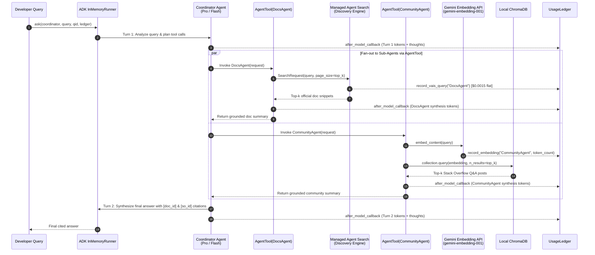

# Architecture, Token Attribution, and Cost Model Reference

This technical reference details the internal implementation of the **Code Assistant Agent** (`code_assistant/` package), the mathematical formulation of the `UsageLedger` cost model, the callback instrumentation on Google ADK (`google-adk==2.3.0`), and the reference-anchored LLM judge pipeline.

---

## 1. Package Module Map

| Module | Primary Symbols | Architectural Responsibility |
| :--- | :--- | :--- |
| [`code_assistant/ledger.py`](../code_assistant/ledger.py) | `UsageRecord`, `UsageLedger` | Records every billable event across LLM calls, embedding requests, and managed Agent Search queries; computes exact USD costs per event and aggregates by query or agent. |
| [`code_assistant/agents.py`](../code_assistant/agents.py) | `build_code_assistant`, `ask`, `measure`, `_model_cb` | Wires the multi-agent hierarchy (`Coordinator`, `DocsAgent`, `CommunityAgent`) using Google ADK `Agent` and `AgentTool`, attaches `after_model_callback`, and executes batched evaluation runs. |
| [`code_assistant/vais.py`](../code_assistant/vais.py) | `ensure_engine`, `make_vais_Docs_tool` | Provisions and queries the managed **Agent Search** (`google-cloud-discoveryengine`) datastore (`code_assistant-docs`) and engine (`code_assistant-docs-engine`), logging one flat `vais_query` charge per search call. |
| [`code_assistant/retrieval.py`](../code_assistant/retrieval.py) | `index_corpus`, `make_search_tool`, `_embed` | Indexes the Stack Overflow community corpus into an in-memory **ChromaDB** collection and embeds search queries with `gemini-embedding-001`, logging embedding token usage on every query. |
| [`code_assistant/quality.py`](../code_assistant/quality.py) | `QA_METRIC`, `score_quality`, `check_challenge_pass` | Wraps the Vertex AI Gen AI Evaluation Service (`EvalTask` + `PointwiseMetric`) to score answers on a 1–5 reference-anchored rubric and normalize scores to `[0.0, 1.0]`. |
| [`code_assistant/data.py`](../code_assistant/data.py) | `load_docs_corpus`, `load_community_corpus`, `load_eval_set`, `load_holdout_set` | Loads the JSONL corpora and evaluation datasets from `assets/`. |
| [`code_assistant/display.py`](../code_assistant/display.py) | `show_ledger`, `show_result`, `show_comparison`, `show_verdict` | Renders HTML scorecards, token/cost summary tables, and Matplotlib charts inside JupyterLab. |

---

## 2. Multi-Agent Control Flow & ADK Wiring

### Why `AgentTool` Instead of Sub-Agent Handoff?
In [`code_assistant/agents.py`](../code_assistant/agents.py), `DocsAgent` and `CommunityAgent` are wrapped in `AgentTool(agent=...)` rather than registered in `sub_agents=[...]`:
- **Sub-Agent Handoff (`sub_agents`)**: Transfers conversation ownership permanently to the child agent for the remainder of the turn. A single sub-agent cannot synthesize answers from *both* official documentation and community discussions.
- **Agent-as-a-Tool (`AgentTool`)**: Runs the sub-agent inside an isolated sub-session, returns its grounded text output to the `Coordinator` as a structured `function_response`, and allows the `Coordinator` to call both specialists and synthesize one unified, cited response.
- **Cost Implication**: Because control returns to the `Coordinator`, the `Coordinator` executes **at least two LLM turns per user query**:
  1. **Turn 1 (Planning / Routing)**: Reads the system instructions and user query, reasons about which tools to invoke, and emits `function_call` parts for `DocsAgent` and `CommunityAgent`.
  2. **Turn 2 (Synthesis)**: Reads the original prompt, its own Turn 1 tool calls, and the full text returned by both sub-agents, then generates the final cited explanation.

---

## 3. Token Attribution & Cost Mathematical Model

### 3.1 Disjoint Prompt Token Splitting
When Gemini responds, `llm_response.usage_metadata` reports:
- `prompt_token_count` ($T_{\text{prompt}}$): The **total** input prompt tokens processed, **including** any tokens served from a context cache.
- `cached_content_token_count` ($T_{\text{cached}}$): The subset of prompt tokens that hit an implicit or explicit context cache.
- `candidates_token_count` ($T_{\text{output}}$): The visible response tokens generated.
- `thoughts_token_count` ($T_{\text{thought}}$): Internal reasoning tokens generated before producing visible output.

To avoid **double-charging** cached tokens at both the full input rate and the cached rate, `_model_cb` in [`code_assistant/agents.py`](../code_assistant/agents.py) splits $T_{\text{prompt}}$ into two disjoint buckets before recording to `UsageLedger`:

$$T_{\text{input (un-cached)}} = \max\left(0,\; T_{\text{prompt}} - T_{\text{cached}}\right)$$

### 3.2 Per-Event Cost Equations

For an **LLM call** on model $m$ with prices $(P_{\text{in}}^{(m)}, P_{\text{cached}}^{(m)}, P_{\text{out}}^{(m)})$ per $1,000,000$ tokens:

$$\text{Cost}_{\text{LLM}}(m) = \frac{T_{\text{input}} \cdot P_{\text{in}}^{(m)} + T_{\text{cached}} \cdot P_{\text{cached}}^{(m)} + \left(T_{\text{output}} + T_{\text{thought}}\right) \cdot P_{\text{out}}^{(m)}}{10^6}$$

> **Critical Billing Rule**: Reasoning tokens ($T_{\text{thought}}$) are generated tokens and are billed at the **output token rate** $P_{\text{out}}^{(m)}$, which is $6\times$ the input token rate across every Gemini 3 tier.

For an **Embedding call** (`CommunityAgent` vector lookup):

$$\text{Cost}_{\text{embed}} = \frac{T_{\text{embed}} \cdot P_{\text{embed}}}{10^6}, \quad P_{\text{embed}} = \$0.15\text{ per }1\text{M tokens}$$

For a **Managed Agent Search query** (`DocsAgent` Discovery Engine lookup):

$$\text{Cost}_{\text{VAIS}} = \frac{P_{\text{VAIS}}}{10^3} = \$0.0015\text{ per query}, \quad P_{\text{VAIS}} = \$1.50\text{ per }1,000\text{ queries}$$

### 3.3 Complete Rate Table

| Model / Service Key | Input Rate ($P_{\text{in}}$ / 1M) | Cached Input Rate ($P_{\text{cached}}$ / 1M) | Output & Thought Rate ($P_{\text{out}}$ / 1M) | Flat Fee |
| :--- | :---: | :---: | :---: | :---: |
| `gemini-3.1-pro-preview` | `$2.00` | `$0.20` (90% off) | `$12.00` | — |
| `gemini-3.5-flash` | `$1.50` | `$0.15` (90% off) | `$9.00` | — |
| `gemini-3.1-flash-lite` | `$0.25` | `$0.025` (90% off) | `$1.50` | — |
| `gemini-embedding-001` (`embedding`) | `$0.15` | — | — | — |
| Agent Search (`vais_query`) | — | — | — | `$1.50 / 1K queries` (`$0.0015/q`) |

---

## 4. Guardrails Against Runaway Generation

In [`code_assistant/agents.py`](../code_assistant/agents.py), two default output token caps are enforced on every `GenerateContentConfig`:
- `SUBAGENT_MAX_OUTPUT = 2048`
- `COORDINATOR_MAX_OUTPUT = 3072`

Without `max_output_tokens`, smaller models (especially `gemini-3.1-flash-lite` when run with `HIGH` thinking) can enter degenerate repetition loops until hitting the model's hard 65,536-token ceiling, turning a budget model call into a `$0.10+` outlier.

---

## 5. Reference-Anchored Quality Evaluation (`code_assistant/quality.py`)

Every optimization lever is validated against an automated LLM judge using the **Vertex AI Gen AI Evaluation Service** (`EvalTask` in `us-central1`).

1. **Evaluation Criteria**:
   - **Correctness**: The response's technical claims and recommended fixes agree with the reference answer and contain no contradicting claims.
   - **Completeness**: The response covers all essential points of the reference answer, addressing every part of multi-part developer questions.
2. **Scoring Rubric (1–5 integer scale)**:
   - `5`: Fully correct and complete; agrees with the reference on all key points.
   - `4`: Correct with minor omissions; agrees with the reference but misses a small detail.
   - `3`: Partially correct; covers some key points of the reference but misses others.
   - `2`: Mostly incomplete or contains an incorrect claim on a key point.
   - `1`: Wrong; contradicts the reference or fails to answer the question.
3. **Linear Normalization to `[0.0, 1.0]`**:
   $$\text{Quality Score} = \frac{\overline{S}_{1..5} - 1.0}{4.0}$$
   where $\overline{S}_{1..5}$ is the mean raw score across the evaluation dataset. A raw average of `4.60 / 5.00` maps to `0.90` (the required quality floor), and our final challenge run achieved `4.875 / 5.00`, mapping to **`0.9688`**.
